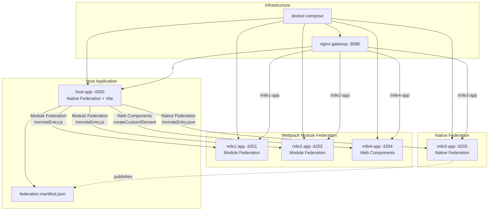

# Angular Federation

Angular microfrontend architecture combining Native Federation and Module Federation.

## Question answered

Can one Angular host load remotes built in different ways (Module Federation, Native Federation, and a Web Component on another Angular major version), and be deployed behind a single gateway?

## When to use it

- You are migrating between federation mechanisms and must run both during the transition.
- A remote needs a different framework major version from its host. Here, [`mfe4-app`](./mfe4-app/package.json) uses Angular 16 inside an Angular 17 host, through a Web Component.
- You want to see how each remote can be built and served in its own container behind a [reverse proxy](./nginx-gateway/conf/default.conf).

## When not to use it

- All your apps can share one federation mechanism. A single mechanism avoids the mixed setup described under trade-offs. See [`react-module-federation`](../react-module-federation/README.md) for a single-mechanism example.
- You want a reference for sharing state or building a business domain: these remotes are starter pages. See [Domain coverage](#domain-coverage).
- One team ships everything on one schedule. See the [family decision guide](../README.md#decision-guide).

## Trade-offs

- **Mixed runtime**: the [host's `main.ts`](./host-app/src/main.ts) initializes both federation runtimes. It uses a deprecated `init()` call because of this mix, as its `FIXME` comment explains.
- **Several integration paths**: [`app.routes.ts`](./host-app/src/app/app.routes.ts) has a different loading approach per mechanism, and the Web Component needs a [wrapper](./host-app/src/app/wrapper/wrapper.component.ts).
- **Web Component overhead**: `mfe4-app` [does not share dependencies as singletons](./mfe4-app/webpack.config.js), so it can load its own copy of Angular. The size of this effect is not measured.
- **Loose coupling**: remotes do not import from the host, and [the host only needs their URLs](./host-app/src/main.ts).

## Domain coverage

See the [store domain](../../domain/store/README.md) for what each area requires.

| Area | Coverage | Notes |
|------|----------|-------|
| Catalog | none | Not implemented |
| Cart | none | Not implemented |
| Checkout | none | Not implemented |

This example demonstrates integration mechanisms only. Adapting it to the store domain is planned as a separate feature.

## How to run it

**Prerequisites**: Node 20, as pinned in [`.nvmrc`](./.nvmrc), and npm. Docker with Compose is needed for production mode. All commands run from this example's directory. Node 20.20.2 and Docker Compose 5.7.0 have been [verified](../../specs/001-repository-foundation/verification.md).

Install dependencies:

```bash
for app in host-app mfe1-app mfe2-app mfe3-app mfe4-app; do (cd "$app" && npm ci); done
```

Development mode (recommended):

```bash
# Start all apps in development mode
./scripts/dev/start.sh

# Stop
./scripts/dev/stop.sh

# Restart
./scripts/dev/restart.sh
```

Open [http://localhost:4200](http://localhost:4200) for the host. Remotes render at `/mfe1`, `/mfe2`, `/mfe3`, and `/mfe4`.

> **Warning**: `stop.sh` force-kills any process listening on ports 4200 to 4204, including processes it did not start.

Production mode:

```bash
# Build everything first: the Docker images copy each app's dist/ directory
./scripts/prod/build-all.sh

# Start the containers; the gateway listens on port 80
docker compose up -d --build

# Stop
docker compose down
```

Open [http://localhost](http://localhost). You can also build images and deploy with `./scripts/prod/deploy.sh`.

## Known limitations

- **Starter content**: every app displays Angular's default starter page, with no business functionality.
- **End-of-life runtime**: [Node 20 reached end of life on 2026-04-30](https://nodejs.org/en/about/previous-releases). It is pinned because of the Angular versions used here, and upgrading them is out of scope. Check [Angular's release table](https://angular.dev/reference/releases) for the support status of Angular 16 and 17.
- **Fixed production host**: the [production manifest](./host-app/src/assets/federation.manifest.prod.json) points `mfe3-app` to `http://localhost`, so deploying to another host needs a change.
- **Not verified**: `scripts/dev/restart.sh`, `scripts/prod/deploy.sh`, and the `scripts/prod/docker-*.sh` scripts.
- **Third-party code**: three host files adapted from `mf-nf-poc` are excluded from the MIT license. See [`THIRD_PARTY_NOTICES.md`](../../THIRD_PARTY_NOTICES.md).
- **Not imported**: an OIDC authentication variant remains on the [`auth-example` branch of the source repository](https://github.com/n0ss4/angular-microfrontends/tree/auth-example).

## Architecture



Summary: A `host-app` loads remote apps (MFE1..MFE4). In production, everything is served through `nginx-gateway` (docker-compose / scripts in `./scripts`).

## Key Services

- `host-app` — Host (dev port: 4200)
- `mfe1-app` — Remote (4201)
- `mfe2-app` — Remote (4202)
- `mfe3-app` — Remote (4203)
- `mfe4-app` — Remote / Web Component (4204)
- `nginx-gateway` — Proxy (production: port 80)

Logs: `./logs/`

## Quick Notes

- Ensure ports 4200–4204 are available in dev.
- The host's federation manifests are in `host-app/src/assets/federation.manifest*.json`.
- For logs: `tail -f logs/<service>.log` or `docker compose logs -f`.

## Contributing

See the repository's [contribution guide](../../CONTRIBUTING.md).

## Acknowledgments

This project was inspired by and built upon excellent resources from the Angular community:

### Articles by Manfred Steyer (Angular Architects)

- **[Micro Frontends with Modern Angular - Part 1: Standalone and esbuild](https://www.angulararchitects.io/blog/micro-frontends-with-modern-angular-part-1-standalone-and-esbuild/)**  
  Foundation for understanding modern Angular microfrontends with Native Federation and esbuild.

- **[Micro Frontends with Modern Angular - Part 2: Multi-Version and Multi-Framework Solutions with Angular Elements and Web Components](https://www.angulararchitects.io/blog/micro-frontends-with-modern-angular-part-2-multi-version-and-multi-framework-solutions-with-angular-elements-and-web-components/)**  
  Deep dive into Web Components integration and multi-version scenarios.

### Example Repository

- **[mf-nf-poc by Manfred Steyer](https://github.com/manfredsteyer/mf-nf-poc)**  
  Proof of concept demonstrating the combination of Native Federation and Module Federation in a single architecture.

Special thanks to Manfred Steyer and the Angular Architects team for their pioneering work in the Module Federation and microfrontends space.

---

For detailed commands and extended documentation, check the scripts in `./scripts/dev` and `./scripts/prod`.

## License

This project is licensed under the MIT License - see the [LICENSE](LICENSE) file for details. The files listed in [`THIRD_PARTY_NOTICES.md`](../../THIRD_PARTY_NOTICES.md) are excluded.
