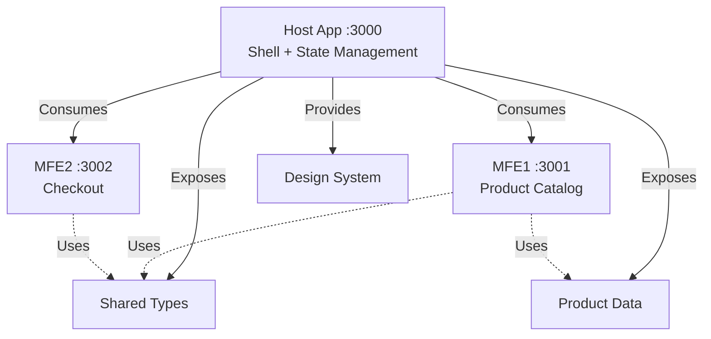

# React Module Federation

A minimal e-commerce application built with React and Module Federation, demonstrating modern microfrontend architecture patterns.

## Question answered

How can independently built React apps form one store at runtime and share a single cart, when a host owns the state and loads its remotes through Module Federation?

## When to use it

- Your apps use one framework, and you can keep its major version aligned across them.
- You want remotes to render as ordinary components inside the host.
- You want a small setup: this example has 3 apps and a [federation configuration](./host_app/module-federation.config.ts) of under 20 lines per app.

## When not to use it

- Your apps need different frameworks or incompatible major versions. See [`angular-federation`](../angular-federation/README.md), whose `mfe4-app` runs on a different Angular major version from its host.
- You need remotes to be built or changed without their host. Here, the remotes import types and data from the host.
- One team ships everything on one schedule. See the [family decision guide](../README.md#decision-guide).

## Trade-offs

- **Mutual dependency**: the [host loads the remotes](./host_app/module-federation.config.ts), and the [catalog](./mfe1_app/src/components/ProviderComponent.tsx) and [checkout](./mfe2_app/src/components/Checkout.tsx) import contracts from the host. [Decision 0001](../../decisions/0001-shared-contract-ownership.md) examines this.
- **Weaker type safety at the boundary**: remotes use `// @ts-ignore` on their imports from the host, so the compiler does not check those contracts.
- **Runtime version coupling**: React and ReactDOM are configured as [shared singletons](./host_app/module-federation.config.ts), so all apps depend on a compatible version.

## Domain coverage

See the [store domain](../../domain/store/README.md) for what each area requires.

| Area | Coverage | Notes |
|------|----------|-------|
| Catalog | full | Exposed by `mfe1_app`; products come from `host_app` |
| Cart | full | State is held in `host_app`, in a Zustand store |
| Checkout | full | Exposed by `mfe2_app`; the confirmation is a browser alert |

Logical events are not sent as events. The host passes the store's cart object to each remote through a React context that the remote exports, and remotes call its methods directly.

## How to run it

**Prerequisites**: Node 24, as pinned in [`.nvmrc`](./.nvmrc), and pnpm 10. Node 24.22.2 and pnpm 10.32.1 have been [verified](../../specs/001-repository-foundation/verification.md). All commands run from this example's directory.

Each app has its own dependencies, so install them separately:

```bash
(cd host_app && pnpm install)
(cd mfe1_app && pnpm install)
(cd mfe2_app && pnpm install)
```

Start the apps, each in its own terminal, starting with the host. `pnpm dev` also opens each app in a browser.

```bash
# Terminal 1: Host
cd host_app && pnpm dev

# Terminal 2: Product catalog
cd mfe1_app && pnpm dev

# Terminal 3: Checkout
cd mfe2_app && pnpm dev
```

Open [http://localhost:3000](http://localhost:3000) to view the application.

To build all apps:

```bash
(cd host_app && pnpm build)
(cd mfe1_app && pnpm build)
(cd mfe2_app && pnpm build)
```

## Known limitations

- **Development URLs only**: [remote URLs](./host_app/module-federation.config.ts) point to `localhost`, so there is no production deployment setup. `pnpm preview` has not been verified.
- **Type generation error**: `mfe1_app` and `mfe2_app` builds log a Module Federation type-generation error (`TYPE-001`), but they exit successfully.
- **Broken export**: [`host_app/src/store/index.ts`](./host_app/src/store/index.ts) exports `useCounterStore`, a module that does not exist. Nothing imports this file.
- **Hotlinked images**: [product images](./host_app/src/data/products.ts) load from third-party retail and vendor sites, so they can break or change. Requests to `plugable.com` and `www.keychron.in` failed during verification.
- **No back end**: placing an order shows a browser alert and clears the cart.
- **Hot reload error**: in development, the browser can log `HMR update failed, performing full reload`. The page reloads and continues working.
- **Build scripts**: pnpm reports that it ignored a build script for `core-js`. All apps still build and run.

## Architecture



- **Host App** (`localhost:3000`) - Shell application with routing, global state (Zustand), and shared resources
- **MFE1** (`localhost:3001`) - Product catalog microfrontend with product grid and cart functionality
- **MFE2** (`localhost:3002`) - Checkout microfrontend with order form and summary

## Module Federation Configuration

### Host App Exposes

```typescript
exposes: {
  './types': './src/types/cart.ts',      // TypeScript interfaces
  './products': './src/data/products.ts', // Product data
}
```

### MFE1 Exposes

```typescript
exposes: {
  '.': './src/components/ProviderComponent.tsx', // Product catalog component
}
```

### MFE2 Exposes

```typescript
exposes: {
  '.': './src/components/Checkout.tsx', // Checkout component
}
```

## Technology Stack

- **React 18** - UI library
- **TypeScript** - Type safety
- **Module Federation** - Runtime microfrontend integration
- **Rsbuild** - Fast build tool
- **Zustand** - Lightweight state management
- **CSS Variables** - Design system tokens

## Project Structure

```
react-module-federation/
├── host_app/           # Shell application
│   ├── src/
│   │   ├── theme.css          # Design system tokens
│   │   ├── types/cart.ts      # Shared TypeScript types
│   │   ├── data/products.ts   # Product catalog data
│   │   ├── store/             # Zustand store
│   │   └── App.tsx            # Main app with routing
│   └── module-federation.config.ts
├── mfe1_app/           # Product catalog MFE
│   ├── src/
│   │   └── components/
│   │       ├── ProviderComponent.tsx
│   │       └── ProviderComponent.css
│   └── module-federation.config.ts
└── mfe2_app/           # Checkout MFE
    ├── src/
    │   └── components/
    │       ├── Checkout.tsx
    │       └── Checkout.css
    └── module-federation.config.ts
```

## Development Notes

- Host must be running before starting remote apps
- All microfrontends share React and ReactDOM as singletons
- Theme CSS is loaded once from host and inherited by all remotes
- Each MFE can run standalone for development/testing

## Created With

```bash
pnpm create module-federation@latest
```

## License

MIT. See the [repository license](../../LICENSE).
